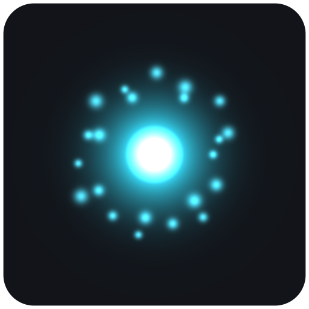
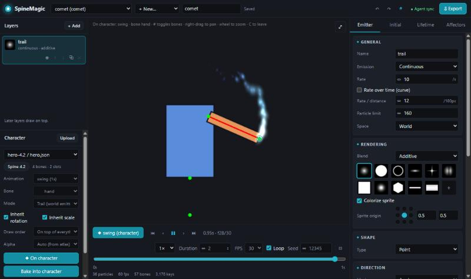
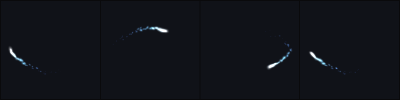
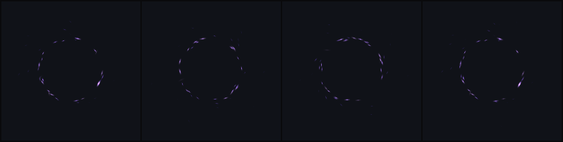
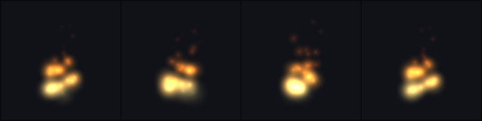
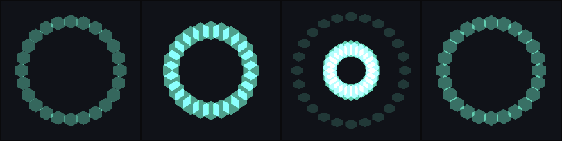
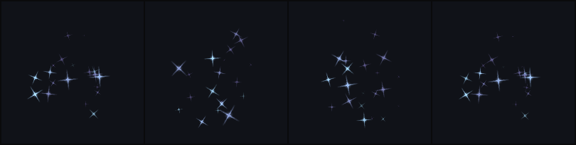

<div align="center">



# SpineMagic

**Particle effects for Spine, made by talking to an AI agent.**

Describe an effect — or show a reference image — and get a Spine skeleton you can drop into the editor or any runtime.
Stick it to a character's hand, leave a trail behind a sword swing, ship it to 3.8 or 4.x.

[](LICENSE)




</div>

---

## Why

Spine has no particle system. The usual workaround is drawing every spark by hand, or exporting video.
SpineMagic **simulates** the particles, **bakes** each one into bones and slots with keyframes, and
**validates** the result by loading and playing it in the official Spine runtime of your version — so what
you get is plain Spine data that works everywhere Spine works.

And because it speaks [MCP](https://modelcontextprotocol.io), an AI agent can do the whole loop for you:
build → look at the rendered preview → adjust → export.

## Gallery

| | |
|---|---|
| **Comet trail** — emitter on a motion path, world-space trail |  |
| **Portal** — vortex + attractor, sparks aligned to velocity |  |
| **Fire** — rising, shrinking, yellow → red additive puffs |  |
| **Hex shield** — bursts fanned evenly in a ring |  |
| **Magic sparkles** — twinkling stars with turbulence |  |

## Features

- **Exports to Spine 3.8, 4.0, 4.1, 4.2 and 4.3** — JSON + atlas + PNG, seamless loops, key reduction,
  every export loaded and played in the matching official runtime.
- **Effects on characters** — bake an effect *into* your character's skeleton under any bone and inside any
  animation. **Follow** sticks it to the bone; **trail** emits along the bone's animated path. One-shot start
  frame, draw-order slot, inherit rotation/scale, premultiplied-alpha matching. Your original files are never touched.
- **A real particle toolkit** — continuous and burst emission, rate over time and over distance, shapes,
  motion paths, inherit velocity, curves and gradients over life, separate size axes, velocity stretch, pivot,
  gravity / drag / wind / noise / vortex / attractor, 11 presets and 11 built-in sprites (or your own PNGs).
- **Agent-first** — 16 MCP tools, previews returned as images the agent can look at, readable validation errors,
  and a bundled **`spine-vfx` skill** that teaches art direction, reference-image matching and bone budgets.
- **Visual editor** — layers, inspector, curve and gradient editors, timeline, live Spine preview, and a
  **Character** panel that previews the effect on your 3.8 or 4.2 character with that version's own runtime.
  Edits made by an agent show up live.

## Quick start

### With Claude Code (recommended)

```bash
claude plugin marketplace add byteblitz-it/spine-magic
claude plugin install spinemagic@spinemagic
```

Restart Claude Code and just ask:

> *Make a gold coin burst for Spine 4.2, mobile, plays once.*
>
> *Our hero is Spine 3.8 at characters/hero/hero.json — add a glowing trail behind the hand during "swing", behind the arm.*
>
> *Here's a screenshot of an effect I like — recreate it for Spine 3.8.*

The plugin ships the MCP server prebuilt (Node.js 20+ is the only requirement) together with the `spine-vfx` skill.

### With any other MCP client

Clone the repo and point your client (Claude Desktop, Cursor, VS Code, …) at the bundled server over stdio:

```bash
node <path-to-repo>/plugin/server/spinemagic-mcp.mjs
```

`SPINEMAGIC_HOME` sets the working folder (default: the server's working directory):
`projects/` effects · `textures/` custom sprites · `characters/` character skeletons · `out/` exports.

### The visual editor

```bash
git clone https://github.com/byteblitz-it/spine-magic.git
cd spine-magic
npm install
npm run web          # → http://localhost:5174
```

Shortcuts: <kbd>Space</kbd> play · <kbd>,</kbd> <kbd>.</kbd> step · <kbd>F</kbd> frame · <kbd>P</kbd> Spine preview ·
<kbd>C</kbd> character preview · <kbd>Ctrl</kbd>+<kbd>Z</kbd> undo.

## Effects on characters

Most of the time an effect belongs *on* something: a glow in a hand, sparks off a blade, a trail behind a dash.

| Mode | What happens | Use it for |
|---|---|---|
| **follow** | The effect is baked under the chosen bone and moves with it — in Spine and in every engine. Optionally stays upright (no rotation) or keeps its size (no scale). | auras, held magic, muzzle flashes, impact points |
| **trail** | The bone's path is sampled from the animation with the real Spine runtime; world-space emitters emit along it, so particles are left behind. | sword arcs, dash streaks, comets from a hand |

The result is written next to your character as `<character>_fx.json` / `.atlas` + `fx_<effect>.png`.
Re-attaching replaces the previous copy, several effects stack, and detaching removes one cleanly.
Every merged file is played through all its animations in the runtime, and the effect's anchor is checked to sit
exactly on the bone.

Try it with the sample heroes: in the editor's **Character** panel choose *add the sample heroes*, or run
`npx tsx scripts/make-test-character.ts`.

## MCP tools

| Tool | Purpose |
|---|---|
| `get_effect_reference` | Every field, default and recipe — read once per session |
| `list_presets` · `list_textures` · `list_effects` | Discover starting points, sprites, saved effects |
| `create_effect` · `get_effect` · `update_effect` | Create from a preset, read, deep-merge patches |
| `add_emitter` · `update_emitter` · `remove_emitter` | Build multi-layer effects |
| `preview_effect` | Contact sheet PNG of the animation, plus bone/key cost |
| `export_spine` · `validate_export` | Export to 3.8 / 4.0 / 4.1 / 4.2 / 4.3 / all, validated in the runtime |
| `inspect_character` · `attach_effect` · `detach_effect` | Bind effects into a character skeleton |

## How it works

```
effect document ──simulate──▶ particles ──assign lanes──▶ bones + slots ──bake──▶ Spine JSON + atlas + PNG
      ▲                           │                                              │
      └──── agent / editor ◀── preview PNG                      load & play in the official runtime
```

Each particle that is alive at the same time gets a *lane* (one bone + one slot) whose translate, rotate,
scale, colour and attachment keys are recorded frame by frame, then reduced. Loops are seamless by construction.
The details are in [docs/DESIGN.md](docs/DESIGN.md).

## Development

| Command | What it does |
|---|---|
| `npm test` | Unit, character and end-to-end MCP tests — baked bones are compared with the simulation inside the real 3.8 / 4.x runtimes |
| `npm run web` | Visual editor with live agent sync |
| `npm run demo [preset]` | Export every preset for every version into `out/` and validate |
| `npm run build:plugin` | Rebuild the bundled server in `plugin/server/` — run after changing `src/` |
| `npm run mcp` | Run the MCP server from source |

```
src/core/    simulation, baking, characters — browser-safe, shared by server and editor
src/node/    file export, runtime validation, bone sampling
src/mcp/     MCP server
web/         editor (Vite + React + PixiJS)
plugin/      Claude Code plugin: bundled server, spine-vfx skill, evals
vendor/      official Spine 3.8 runtime (not published on npm)
```

## License

SpineMagic is MIT-licensed — © 2026 ByteBlitz IT Solutions. See [LICENSE](LICENSE).

The Spine runtimes used for validation and previews are © Esoteric Software under the Spine Runtimes License,
and using Spine data in a product requires a Spine license from Esoteric Software — see
[THIRD-PARTY-NOTICES.md](THIRD-PARTY-NOTICES.md). SpineMagic is not affiliated with or endorsed by Esoteric Software;
Spine is a trademark of Esoteric Software LLC.
